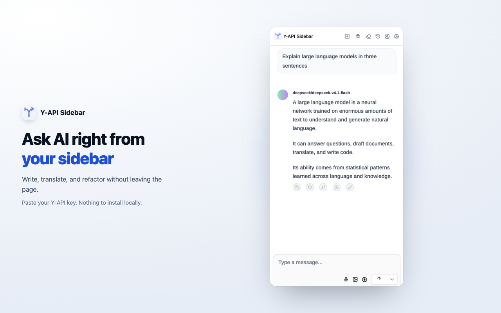
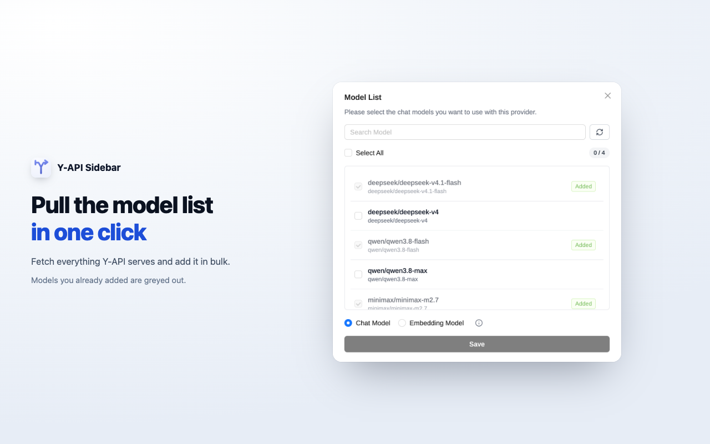
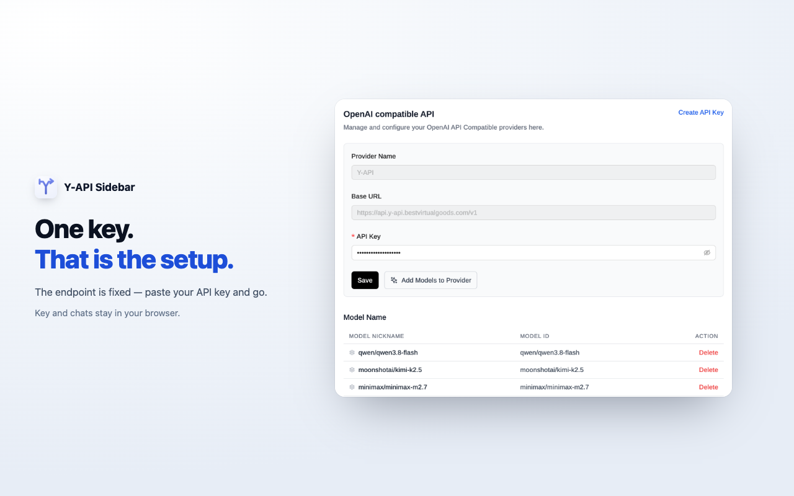

<p align="center">
  
</p>

<h1 align="center">Y-API Sidebar</h1>

<p align="center">
  <a href="LICENCE"></a>
  <a href="https://chromewebstore.google.com/"></a>
  
  
</p>

<p align="center">
  An open-source AI assistant that lives in your browser's side panel.<br>
  Ask about the page you're reading, or just chat. Bring your own API key.
</p>

---

## Why this exists

Most browser AI assistants either lock you into one vendor, or make you install
a local model runtime before the first message. This one does neither: paste an
API key, and you are talking to the page in front of you.

It is a fork of [Page Assist](https://github.com/n4ze3m/page-assist), reduced to
a single purpose and pointed at [Y-API](https://y-api.bestvirtualgoods.com/).

<p align="center">
  
</p>
<p align="center">
  
  
</p>

## Features

- **Ask about the current page** — the side panel reads the page you are on.
- **Plain chat** — a normal chat window, same key, same history. The full-page
  Playground view is one click away.
- **Images** — paste or drop a screenshot and ask about it, or run OCR locally.
- **Local history** — conversations live in IndexedDB. Export to txt / md / json
  / png whenever you want.
- **Reasoning models** — thinking output is shown separately and can be toggled
  per chat.
- **20 languages** in the UI, 14 in the store listing.

## Install

### From the Chrome Web Store

*(link once published)*

### From source

```bash
git clone https://github.com/jiweiyeah/y-api-sidebar.git
cd y-api-sidebar
bun install
bun run build:chrome     # → build/chrome-mv3
```

Then open `chrome://extensions`, turn on **Developer mode**, click **Load
unpacked**, and pick `build/chrome-mv3`.

## Getting an API key

1. Sign up at <https://y-api.bestvirtualgoods.com/>.
2. Create a key under [API Keys](https://y-api.bestvirtualgoods.com/app/keys).
3. Open the extension settings → **OpenAI Compatible API**. There is exactly one
   provider (Y-API) and its endpoint is fixed. Paste your key and save.
4. Under **Manage Models**, add the model ids you want (the picker fetches the
   live list from Y-API). They appear in the model selector immediately.

The base URL is not editable: this build talks only to
`https://api.y-api.bestvirtualgoods.com/v1`.

## Configuration

| Setting | Where | Notes |
| --- | --- | --- |
| API key | Settings → OpenAI Compatible API | The only credential; stored locally |
| Enabled models | Settings → Manage Models | Only added models show up in the picker |
| Per-chat model settings | Chat header → brain icon | System prompt, temperature, top-k/p, reasoning effort |
| Theme / language | Settings → General | Light, dark, system |
| Default OCR language | Settings → General | Local OCR only, no network |

## Development

```bash
bun run dev              # Chrome with HMR
bun run dev:firefox      # Firefox
bun run build:chrome     # Production build
bun run zip              # Store-ready zip in build/
bun run compile          # Type-check only
```

Built with [WXT](https://wxt.dev/), React 18, TypeScript, Tailwind and Ant
Design. `wxt.config.ts` holds the manifest; `src/utils/oai-api-providers.ts`
holds the provider presets.

### Repository layout

```
src/
  entries/           background worker, options page, side panel
  components/        UI, split by surface (Option / Sidepanel / Common)
  db/dexie/          IndexedDB schema and queries
  models/            OpenAI-compatible chat adapter
  services/          Model list, settings, OCR, title generation
  utils/             Provider constants, helpers
docs/images/         Screenshots used in this README and the store listing
```

## What changed from upstream

See [CHANGELOG.md](CHANGELOG.md#fork-notes). In short: rebranded, cut down to a
single fixed Y-API provider, and everything outside chat removed — RAG over
uploaded documents, knowledge bases, saved prompts, MCP, WebMCP, page actions,
web search, TTS, YouTube summaries and web share.

## Privacy

The extension stores everything locally and sends only your chat requests to the
endpoint you configure. Full policy: [PRIVACY.md](PRIVACY.md).

## Contributing

Issues and pull requests are welcome. Before opening a PR:

```bash
bun run compile   # must be clean
```

Keep changes small and focused. If you are syncing from upstream Page Assist,
note the upstream commit in the PR description.

## Credits

Built on [Page Assist](https://github.com/n4ze3m/page-assist) by Muhammed Nazeem,
MIT licensed. The original copyright notice is preserved in [LICENCE](LICENCE).

## Licence

MIT — see [LICENCE](LICENCE).
